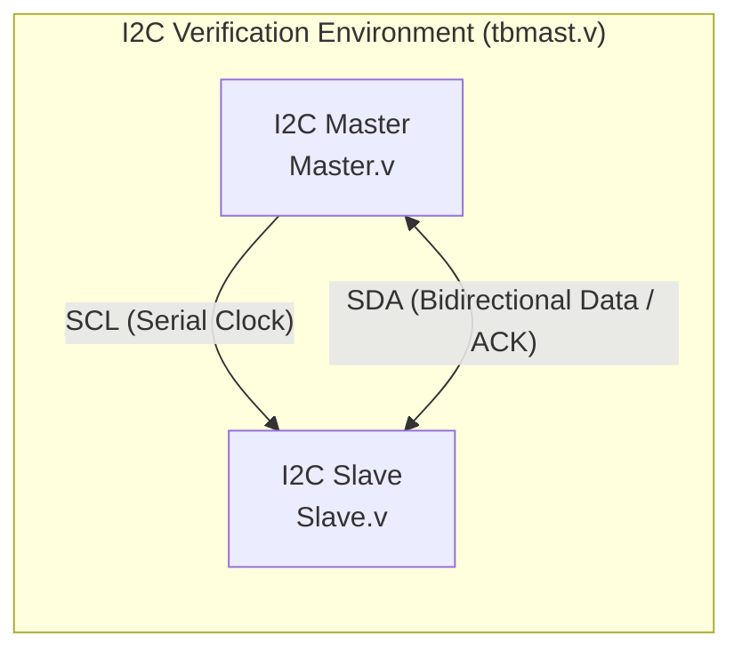
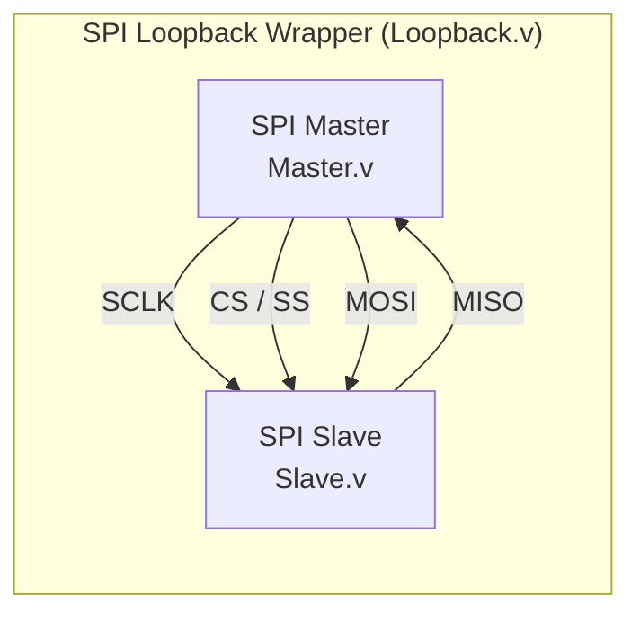
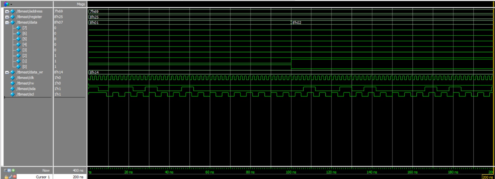
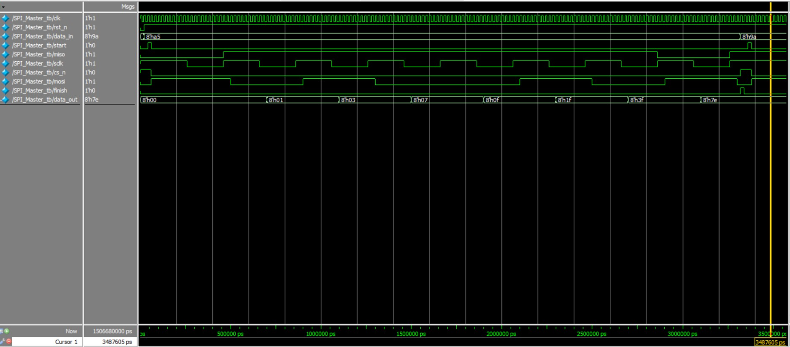

# I2C & SPI Protocol Controllers in Verilog

Synthesizable Verilog RTL implementations of Master and Slave controllers for both I2C (Inter-Integrated Circuit) and SPI (Serial Peripheral Interface) serial communication protocols, complete with verification testbenches and loopback wrappers.

## Overview

On-chip and board-level peripheral communication relies heavily on synchronous serial buses like I2C and SPI. This repository provides clean, standalone RTL implementations of both protocols in Verilog HDL. The I2C block handles half-duplex two-wire bidirectional transfers with start/stop framing and address/data ACK handshaking, while the SPI block implements a high-speed 4-wire full-duplex shift-register architecture with a dedicated top-level loopback wrapper for end-to-end verification.

## Features

- **I2C Controller (`I2C/`)**
  - Two-wire bidirectional serial interface (`SDA` and `SCL`).
  - FSM-driven Master (`Master.v`) and Slave (`Slave.v`) controllers.
  - Supports Start condition, 7-bit Slave addressing, Read/Write bit control, ACK/NACK handshaking, 8-bit data frame transfers, and Stop condition generation.
- **SPI Controller (`SPI/`)**
  - Standard 4-wire synchronous serial interface (`SCLK`, `MOSI`, `MISO`, `SS`/`CS`).
  - Simultaneous full-duplex data transmission between Master (`Master.v`) and Slave (`Slave.v`).
  - Top-level interconnect module (`Loopback.v`) tying Master and Slave ports together for closed-loop functional verification.
- **Verification & Waveforms**
  - Dedicated Verilog testbenches (`tbmast.v` and `Master_tb.v`) verifying read/write transactions and bit-level serial timing.
  - Pre-captured simulation waveform screenshots (`I2C.png` and `SPI.png`) included for quick reference.

## Architecture

### 1. I2C Bus Architecture
The I2C design uses an explicit finite state machine to sequence through bus idle, start condition (`SDA` pulled low while `SCL` is high), address shift, read/write direction bit, slave acknowledgement, 8-bit payload transfer, and stop condition (`SDA` pulled high while `SCL` is high).



### 2. SPI Bus Architecture
The SPI design is built around synchronous shift registers. When the Master asserts the active-low slave select line and drives the serial clock (`SCLK`), data is shifted out on `MOSI` and sampled in on `MISO` simultaneously on each clock cycle. `Loopback.v` wraps both modules into a single top-level entity for verification.



## Repository Structure

```text
I2C-SPI-Protocols/
├── I2C/
│   ├── Master.v       # I2C Master RTL (FSM, SCL generator, SDA control)
│   ├── Slave.v        # I2C Slave RTL (address matching, ACK, data shift)
│   ├── tbmast.v       # Top-level testbench for I2C Master-Slave transactions
│   └── I2C.png        # Simulation waveform for I2C read/write transfers
├── SPI/
│   ├── Master.v       # SPI Master RTL (clock divider, shift register, CS logic)
│   ├── Slave.v        # SPI Slave RTL (synchronous shift register)
│   ├── Loopback.v     # Top-level wrapper connecting SPI Master and Slave
│   ├── Master_tb.v    # Verification testbench for the SPI controller
│   └── SPI.png        # Simulation waveform for SPI full-duplex operation
└── README.md          # Project documentation
```

## Requirements

- **Simulator:** ModelSim / QuestaSim, Icarus Verilog (`iverilog`), or Xilinx Vivado Simulator (`xsim`).
- **Waveform Viewer:** GTKWave (if using Icarus Verilog) or built-in GUI wave viewer in ModelSim/Vivado.
- **Synthesis (Optional):** Yosys, Xilinx Vivado, or Intel Quartus Prime.

## How to Simulate

### Option 1: Using Icarus Verilog & GTKWave

**Simulate I2C:**
```bash
cd I2C
iverilog -o i2c_sim.vvp Master.v Slave.v tbmast.v
vvp i2c_sim.vvp
```

**Simulate SPI:**
```bash
cd ../SPI
iverilog -o spi_sim.vvp Master.v Slave.v Loopback.v Master_tb.v
vvp spi_sim.vvp
```
*(Note: If your testbench includes `$dumpfile` and `$dumpvars`, open the generated `.vcd` file with `gtkwave <filename>.vcd`.)*

### Option 2: Using ModelSim

**Simulate I2C:**
```tcl
vlib work
vlog I2C/Master.v I2C/Slave.v I2C/tbmast.v
vsim work.tbmast
add wave -r /*
run -all
```

**Simulate SPI:**
```tcl
vlib work
vlog SPI/Master.v SPI/Slave.v SPI/Loopback.v SPI/Master_tb.v
vsim work.Master_tb
add wave -r /*
run -all
```

## How to Synthesize / Run on FPGA

1. **Using Yosys (Open-Source Synthesis):**
   ```bash
   # Synthesize I2C Master
   yosys -p "read_verilog I2C/Master.v; synth -top Master; stat"

   # Synthesize SPI Loopback
   yosys -p "read_verilog SPI/Master.v SPI/Slave.v SPI/Loopback.v; synth -top Loopback; stat"
   ```
2. **Using Xilinx Vivado:**
   - Create a new RTL project and add the Verilog design sources (`Master.v`, `Slave.v`, and `Loopback.v`) from either the `I2C/` or `SPI/` directory.
   - Add the corresponding testbench (`tbmast.v` or `Master_tb.v`) under Simulation Sources.
   - Run **RTL Analysis -> Open Elaborated Design** to inspect the schematic, or run **Synthesis** targeting your FPGA board `[add target FPGA part number if applicable]`.

## Results

### Simulation Waveforms

**I2C Transaction Waveform:**


**SPI Full-Duplex Transaction Waveform:**


### Resource Utilization & Timing
- **Target Device:** `[add target FPGA / ASIC library]`
- **LUT / Gate Count:** `[add LUT / cell usage]`
- **Flip-Flops:** `[add FF count]`
- **Max Operating Frequency ($F_{max}$):** `[add timing result]`

## Future Work

- Parameterize SPI clock polarity (`CPOL`) and clock phase (`CPHA`) to support all four SPI operating modes (Modes 0–3).
- Add support for I2C clock stretching, repeated start conditions, and 10-bit slave addressing.
- Integrate parameterized TX/RX synchronous FIFOs at the host interface of both controllers to buffer burst transfers.
- Wrap the controllers with an AMBA APB or AXI4-Lite slave interface for plug-and-play integration with a RISC-V SoC.

## Author

**Shaman Singh Multani**  
B.Tech in Electronics Engineering (VLSI Design & Technology)  
GitHub: [@ShamanSinghMultani](https://github.com/ShamanSinghMultani)
